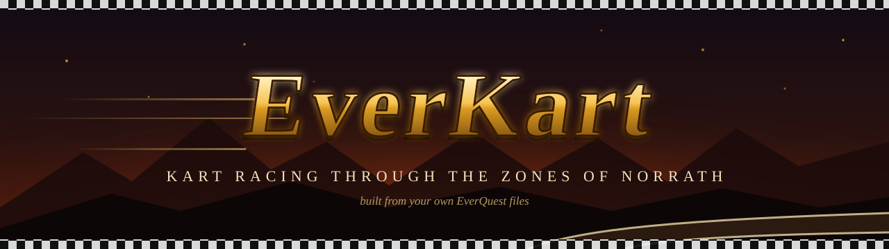
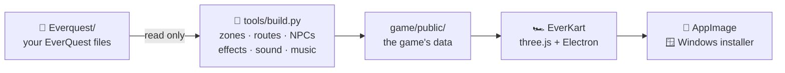

<p align="center">
  
</p>

<p align="center">
  
  
  
  
  <br>
  
  
  
  
  
</p>

<p align="center">
  <b>A kart racer through real EverQuest zones</b>: the actual zone geometry, textures and lighting,<br>
  EverQuest's own creatures and characters beside the track, EverQuest races at the wheel,<br>
  and each zone's own music, all built from <b>your own EverQuest files</b>.
</p>

<p align="center">
  <a href="#-getting-started">Getting started</a> ·
  <a href="#-controls">Controls</a> ·
  <a href="#-tracks">Tracks</a> ·
  <a href="#-how-it-works">How it works</a> ·
  <a href="ROADMAP.md">Roadmap</a> ·
  <a href="CONTRIBUTING.md">Contributing</a>
</p>

---

## ✨ Features

- **Sixteen tracks through classic Norrath.** Veeshan's Peak, Temple of Veeshan, Kael Drakkal,
  Greater Faydark, Butcherblock, North Karana, the Commonlands, the Planes of Fear, Hate,
  Growth and Mischief, and more. Each is a real
  kart track laid through the real zone: a smooth road in the zone's own stone, with kerbs and
  walls along its edges.
- **EverQuest's skies and weather.** Each zone shows its own sky from the game's files, through
  a day and a night; rain sweeps the Karanas and Faydwer and snow falls on Everfrost, with
  lightning and thunder in a storm.
- **The zone is alive.** Named NPCs stand at their real spawn points, and dragons breathe fire
  at passing karts. An 18-strong raid takes on Silverwing in Veeshan's Peak, and a monk trains
  racnar down a hallway.
- **49 racers.** All 13 classic player races, male and female, in every armor set, plus
  EverQuest NPC models, seated in hand-built karts flying EverQuest banners. You pick one from a
  turning showroom of the real racers.
- **A campaign.** Four cups across Norrath with points, standings and a podium, and gold,
  silver and bronze trophies to win.
- **Spells as items.** Spirit of Wolf, Flame Bolt, Ice Comet, Snare, Gate, Invisibility and more, each with
  its own particle effect from EverQuest.
- **Kart racing done right.** Drifting with mini-turbos, rubber banding, CPU rivals, a course
  flyover before every race, and full controller support.
- **EverQuest's sound.** Each zone's own music and EverQuest's own sound effects. The finish line
  gets the level-up ding.

> [!IMPORTANT]
> **EverKart contains no EverQuest files.** You copy your own EverQuest folder into the project
> and the build makes the game from it. The game you build contains EverQuest's art, so it is
> yours alone: please don't share builds.

## 🚀 Getting started

### 1. Get EverKart

```bash
git clone https://github.com/Ekco-S64QTN6/EverKart.git
```

Or use **Code → Download ZIP** above and unpack it.

### 2. Copy your EverQuest folder into `Everquest/`

Copy everything in your EverQuest game folder into the project's **[`Everquest/`](Everquest/)**
folder, so that `Everquest/global_chr.s3d` exists. EverKart is built and tested with the
[Project 1999](https://www.project1999.com/) client.

### 3. Run the installer

<table>
<tr><th>🐧 Linux</th><th>🪟 Windows</th></tr>
<tr valign="top"><td>

```bash
./install.sh
```

It checks for Python, Node.js and FFmpeg and offers to install anything missing. It then builds
the game and adds **EverKart** to your applications menu (Games).

</td><td>

Double-click **`install.bat`**.

It checks for Python, Node.js and FFmpeg and installs anything missing with `winget`. It then
builds the game and runs **EverKart's installer**: Start menu and desktop shortcut.

</td></tr>
</table>

The first build takes a while: it pulls 14 zones, their creatures, the racers, effects,
sounds and music out of your EverQuest files. It needs about **4 GB** of free disk space. Full
details, options and troubleshooting are in **[docs/INSTALL.md](docs/INSTALL.md)**.

### 4. Race

Start **EverKart** from your applications menu or Start menu. It starts fullscreen; **F11**
toggles a window.

## 🎮 Controls

| | Keyboard | Controller |
|---|---|---|
| Steer | ← → / A D | Left stick, D-pad |
| Accelerate | ↑ / W | A |
| Brake / reverse | ↓ / S | B |
| Drift (hop, then release for a mini-turbo) | Space | RB / RT |
| Cast your spell | E / Shift | LB / LT / Y |
| Look behind (hold) | Q / C | X |
| Back on the track | R | Back / View |
| Pause | Esc / P | Start / Menu |

Options → Controls has a second controller layout, **Triggers**: RT accelerates and LT brakes
(both pressure-sensitive), RB drifts, LB or Y casts.

**Drifting:** hold drift while turning at speed. Steering into the turn charges it faster.
The sparks go white, then blue (small turbo), then orange (big turbo); let go to boost.

## 🏁 Tracks

| Track | Zone | Race |
|---|---|---|
| **Veeshan's Peak** | Through the dragons' halls, past Hoshkar's island to Phara Dar's lair | Point to point, ~10,300 |
| Temple of Veeshan | Dragon halls of the north wing | 3 laps |
| Kael Drakkal | Around the giants' arena | 3 laps |
| Greater Faydark | Forest trails under Kelethin | 2 laps |
| Oasis of Marr | Around the oasis, across the dunes | 2 laps |
| Everfrost Peaks | Ice canyons and the frozen plain | 2 laps |
| Nektulos Forest | Under the dark canopy | 2 laps |
| Lavastorm Mountains | Between the lava flows | 2 laps |
| Plane of Fear | Past the temple of Cazic-Thule | 2 laps |
| Plane of Hate | Innoruuk's plaza and tower | 4 laps |
| Plane of Growth | Around Tunare's tree | 2 laps |
| Plane of Mischief | Bristlebane's garden | 3 laps |
| Estate of Unrest | Round the haunted mansion | 4 laps |
| Butcherblock Mountains | From the docks to the gates of Kaladim | 2 laps |
| North Karana | Across the plains to the druid circle | 2 laps |
| East Commonlands | The road from the gates of Freeport | 2 laps |

Veeshan's Peak is the reference track: the others are being brought up to its standard (see
the [roadmap](ROADMAP.md)).

## 🔧 How it works



The build reads EverQuest's own archives (`.s3d` zones and characters, `.wld` geometry,
`spellsnew.eff` effects, `snd*.pfs` sounds, `.xmi` music). For each track it plans a drivable
route over the zone's real floor and lays a kart track along it. It poses EverQuest's character
models in their own animations, and packages everything into a desktop app.

How every piece is made is described in **[docs/HOW_IT_WORKS.md](docs/HOW_IT_WORKS.md)**, and
how to turn a zone into a track in **[docs/TRACK_GUIDE.md](docs/TRACK_GUIDE.md)**. The plan for
split-screen and online multiplayer is **[docs/MULTIPLAYER.md](docs/MULTIPLAYER.md)**.

## 📂 Project layout

```
everkart/
├── Everquest/        📁 your EverQuest files go here (empty in the repository)
├── game/             🏎️ the kart racer: src/ (three.js), electron/ (desktop app), tools/ (tests)
├── tools/            🐍 the build: reads Everquest/, writes the game's data (build.py runs it all)
├── tracks/           🏁 one file per track: route, inhabitants, scenes, music
├── docs/             📖 install guide, how it works, how to make a track
├── install.sh        🐧 Linux installer
├── install.bat       🪟 Windows installer (runs install.ps1)
├── ROADMAP.md        🗺️ the plan and what is being worked on
└── CONTRIBUTING.md   🤝 working on EverKart
```

## 🛠️ Development

```bash
python3 -m venv .venv && .venv/bin/pip install -r tools/requirements.txt
.venv/bin/python tools/build.py vpeak   # one track's data (fast), no app build
cd game && npm install && npm run dev   # the game in a browser with hot reload: localhost:5199
npm run dist                            # the desktop app for this system
```

Start a race directly: `http://localhost:5199/?track=vpeak&nointro`. The desktop app takes
`--track=kael --racer=OGM_3 --windowed --mute --laps=1`. See [CONTRIBUTING.md](CONTRIBUTING.md).

## 🗺️ Roadmap

Veeshan's Peak is being perfected first. Next come a studio-quality front end (title screen,
options, a campaign, and a carousel character select with every model riding correctly), then
every other track brought to the same standard. The full plan is in **[ROADMAP.md](ROADMAP.md)**.

## ⚖️ Legal

EverKart is a free, non-commercial fan project. It is **not affiliated with, endorsed by or
sponsored by Daybreak Game Company LLC** or the Project 1999 team. *EverQuest* and *Norrath* are
trademarks of Daybreak Game Company LLC.

This repository contains **no EverQuest files and nothing made from them**. All of EverQuest's
art, models, sounds and music come from the player's own copy, at build time, on the player's
own machine. Builds of the game contain that material and must not be distributed.

## 🙏 Acknowledgements

- [Project 1999](https://www.project1999.com/): keeping classic EverQuest alive
- **Brewall's EverQuest maps**: where Norrath's named NPCs stand
- [pqdi.cc](https://www.pqdi.cc/): classic zone header data (fog, sky, view distance)
- **LanternEQ**: research into EverQuest's music files
- [three.js](https://threejs.org/), [three-mesh-bvh](https://github.com/gkjohnson/three-mesh-bvh),
  [Electron](https://www.electronjs.org/), [Vite](https://vitejs.dev/), [FluidSynth](https://www.fluidsynth.org/)
- Everyone who ever trained a train of racnar to the zone line
